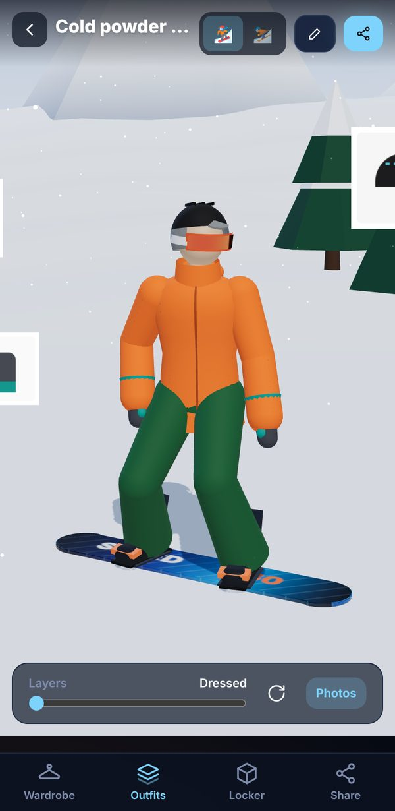
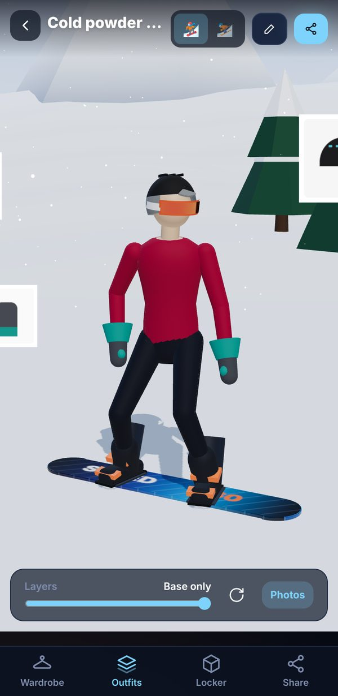
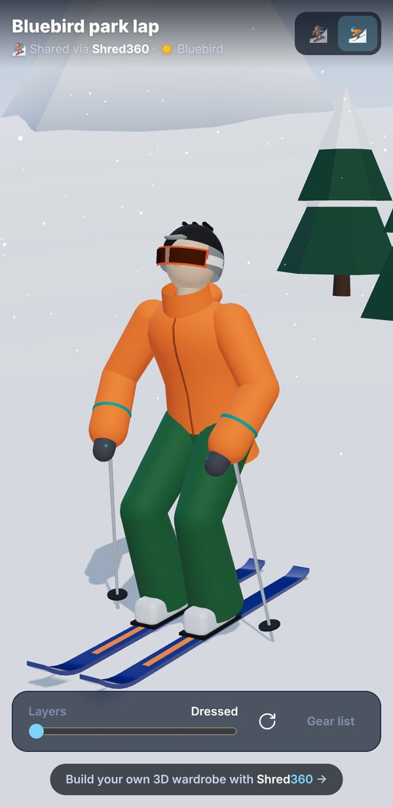
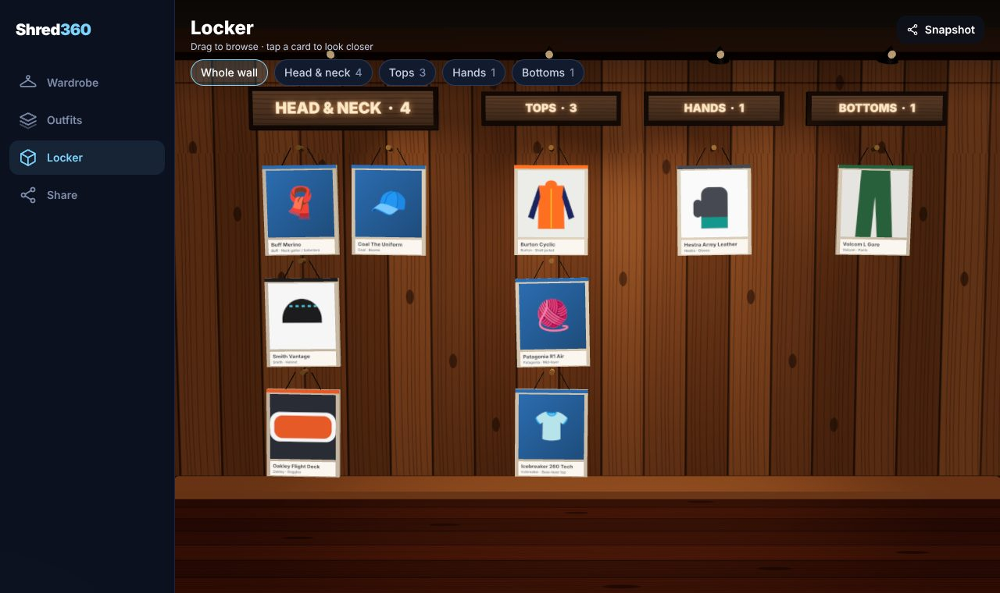

# Shred360

**Your real ski & snowboard wardrobe, in 3D.** Photograph the gear you actually own, build outfits
from it, spin them around on a 3D rider, browse everything on a 3D gear wall, and share your fits
as a link, an image or a 360° video.

<p align="center">
  
  
  
</p>
<p align="center">
  
</p>

## Features

- **Wardrobe of real gear.** Add items with photos from the camera or gallery. Photos are resized
  on-device and their main colours are picked up automatically, so the 3D rider matches what you
  own. Each category has its own specs (waterproofing, insulation, lens VLT, MIPS, fit…), plus
  purchase info, tags and notes. Search by brand, colour family ("orange"), tag or type.
- **v1 gear types:** shell and insulated jackets, mid-layers, base tops and bottoms, pants, bibs,
  socks, neck gaiters/balaclavas, helmets, goggles, beanies, gloves and mittens. Boards, skis,
  boots and bindings are next (the data model is ready for them).
- **Outfit builder.** Fill slots from head to toe (helmet → goggles → gaiter → jacket → mid →
  base → gloves → pants → base bottom → socks) with a live 2D preview, ski/snowboard toggle and
  condition tags (powder, bluebird, cold, park…).
- **3D Fit Check.** A procedural rider on a snowy slope wears the outfit in your items' colours,
  pattern (solid, colour-block, camo, print) and finish (matte or glossy): mirrored goggle lens,
  helmet vents, puffy baffles, bib straps and more. Orbit around it, switch between snowboard and
  ski stance, tap a garment to see the real item, and use the **layer peel** slider to fade the
  shell and mid layers away. Your item photos float around the rider as cards.
- **3D Locker.** A wooden chalet gear wall where every item hangs as a framed photo card under
  zone signs (Head & neck, Tops, Hands, Bottoms). Drag to browse, jump to a zone, or tap a card to
  fly the camera to it.
- **Sharing.**
  - _Share link_: the outfit (names, brands, colours, pattern, finish) is packed into the URL, so
    friends open it in 3D on any device. No server, and your photos never leave your phone.
  - _Snapshot_: a captioned PNG of the current 3D view (rider or locker).
  - _360° video_: records one full spin around the rider (MP4 where supported, else WebM).
- **Backup & restore.** Export the whole wardrobe, photos included, as a `.zip` and import it on
  another device (merge or replace).
- **Installable & offline.** A PWA: add it to your home screen and it works without a connection.

## Privacy: local-first

Everything is stored in your browser (IndexedDB) on your device. There is no account and no
server. The storage layer sits behind a `WardrobeRepository` interface
(`src/data/WardrobeRepository.ts`), so cloud sync (e.g. Supabase) can be added later without
touching the UI.

## Getting started

Requires Node 20.19+ (22 recommended).

```bash
npm install
npm run dev          # http://localhost:5173
```

To try it on your phone over your LAN, run `npm run dev -- --host` and open the shown network URL.
Camera capture and the share sheet need HTTPS in most mobile browsers; use the deployed site, or
a tunnel, for those.

| Script              | What it does                                                |
| ------------------- | ----------------------------------------------------------- |
| `npm run dev`       | Dev server with hot reload                                  |
| `npm run build`     | Production build (+ service worker) into `dist/`            |
| `npm run preview`   | Serve the production build                                  |
| `npm test`          | Unit tests (Vitest)                                         |
| `npm run test:e2e`  | End-to-end tests (Playwright, Chromium with software WebGL) |
| `npm run lint`      | ESLint                                                      |
| `npm run typecheck` | TypeScript                                                  |
| `npm run check`     | lint + typecheck + unit tests + build                       |

For e2e runs with an existing Chromium binary instead of `npx playwright install`, set
`PLAYWRIGHT_CHROMIUM_PATH=/path/to/chrome`.

## Deploying

`.github/workflows/deploy.yml` builds and deploys to **GitHub Pages** on every push to `main`
(served from `/<repo-name>/`). Enable it once under _Settings → Pages → Source: GitHub Actions_.
The app uses hash routing, so deep links and share links work on any static host. For other
hosts, build with `BASE_PATH=/your/path/ npm run build`.

`.github/workflows/ci.yml` runs lint, typecheck, unit tests, build and the Playwright suite on
pushes to `main` and on pull requests.

## How it's built

- **Vite + React 19 + TypeScript**, Tailwind CSS v4, React Router (hash routing).
- **3D:** three.js via `@react-three/fiber` and `@react-three/drei`.
  - The rider is built entirely in code, with no model files. A small skeleton
    (`src/features/rider/skeleton.ts`) poses the snowboard/ski stance with two-bone IK, so feet
    land on the board or skis.
  - Each limb is a tapered lathe segment between two joints, and every garment is the same
    segment drawn slightly larger. That's what makes layering and the peel effect work.
  - Labels and signs are drawn on canvas textures, and the environment map is procedural, so
    nothing is fetched from a CDN and the 3D views work offline.
- **Storage:** Dexie (IndexedDB). Photos are stored as Blobs at 1600px plus a 512px thumbnail.
- **Sharing:** `lz-string` for links, `MediaRecorder` + `canvas.captureStream()` for video,
  `fflate` for backup zips, the Web Share API where available.
- **PWA:** `vite-plugin-pwa` (Workbox precache, update prompt, install button).

```
src/
  domain/      categories registry, item/outfit types and helpers, outfit → 3D "look"
  data/        WardrobeRepository interface, Dexie implementation, React hooks, backup zip
  media/       image resizing, colour extraction
  share/       share-link encoding, snapshots, turntable recording
  features/
    wardrobe/  list, item form (photos, colours, specs), item details
    outfits/   outfit builder, outfit list, flat 2D rider preview
    rider/     3D rider: skeleton, garments, hardgoods, slope scene, Fit Check page
    locker/    3D gear wall: layout, cards, camera rig
    share/     share panel, shared-link viewer, Share & backup page
  ui/          layout, buttons, icons, PWA prompts
```

### Adding a new kind of gear

Add an entry to `CATEGORIES` in `src/domain/categories.ts` with its slot, locker zone, colour role
names and spec fields. If it needs a new 3D shape, add a garment component under
`src/features/rider/garments/` and render it from `Rider.tsx`.

## Roadmap

- Hardgoods: boards, skis, boots and bindings as wardrobe items (replacing the generic ones on the
  rider and filling the locker's boot shelf)
- Optional cloud sync and share links that include photos
- Background removal for item photos
- Per-item usage log (days on snow) and packing lists
